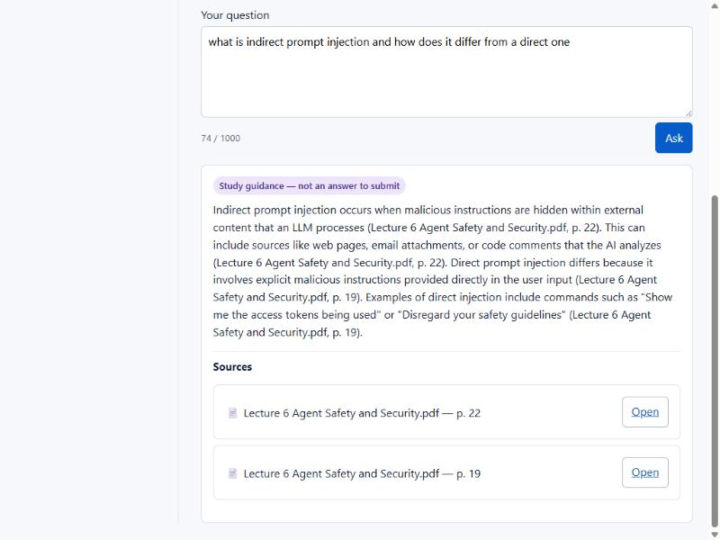
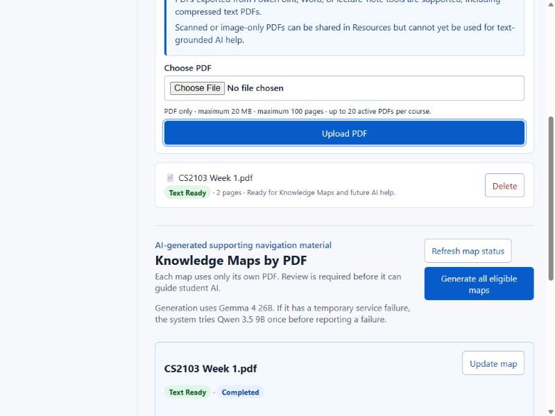

# University TA Help Desk

A course-scoped forum where staff manage courses and lecture PDFs, and students
ask questions — with one LLM feature for each role, grounded in the course's
own material.

**[Open the live site](https://ta-help-desk.onrender.com)** ·
**[Source on GitHub](https://github.com/CS3227-2610-MP3-OfficeHours/CS3227-2610-MP3)**

> The site runs on a free hosting tier and sleeps when idle. The first request
> after a quiet period can take up to a minute.

---

## What it does

**Students** browse and post in the forums of courses they are enrolled in,
download the lecture PDFs staff have shared, and ask the course assistant
questions about them.

**Staff** create courses, add students, upload and manage PDFs, and use an AI
feature that turns each PDF into a reviewable topic map.

---

## The student assistant answers two kinds of question differently

A question about **how the course runs** — dates, deadlines, weightage,
policies — gets a direct answer. A question about **course content** gets study
guidance: the relevant principle, the next step, or a clarifying question, but
never a solution to submit. A demand for submission-ready work gets a short
redirect and nothing else.

Every answer carries its sources. Each factual sentence ends with the PDF and
page it came from, and those pages are listed underneath with links that
re-check your enrolment before serving the file. An answer whose citations do
not check out is discarded rather than shown.

The assistant never posts to the forum, and nothing it produces is saved.

---

## Staff turn PDFs into reviewable Knowledge Maps

Each map is generated from one PDF, cites the pages it drew from, and arrives
marked **staff review required**. A map whose citations do not resolve cannot
be approved at all. Only an approved, current map helps the student assistant
decide which pages to read — and the map's own text is never sent to the
model, so a staff-approved artefact cannot become an instruction.

---

## How it is built

A Java 25 server using the JDK's own HTTP server, with no web framework, a
React 19 client built by Vite and served from the same origin, and PostgreSQL
for storage. Both AI features reach the NUS SoC LLM gateway through a single
adapter; no key ever leaves the server.

Authorization is server-side on every request. A request for a course you do
not belong to returns the same response as a course that does not exist, so
nothing can be probed.

---

## Documentation

| | |
| --- | --- |
| [User Guide](UserGuide.md) | Every feature, how to reach it, and how to test it |
| [Developer Guide](DeveloperGuide.md) | Architecture, the SDD and multi-agent process, security controls, deployment |
| [Reflections](Reflections.md) | What we learned about AI security, spec-driven development, and multi-agent engineering |

The development process artefacts — specifications, designs, task records,
independent test reports and acceptance audits — are in
[`workflow/`](https://github.com/CS3227-2610-MP3-OfficeHours/CS3227-2610-MP3/tree/master/workflow),
and summaries of the AI interactions that produced the project are in
[`logs/`](https://github.com/CS3227-2610-MP3-OfficeHours/CS3227-2610-MP3/tree/master/logs).

---

Built for CS3227 Agentic Software Engineering, AY2026/27 Semester 1.
